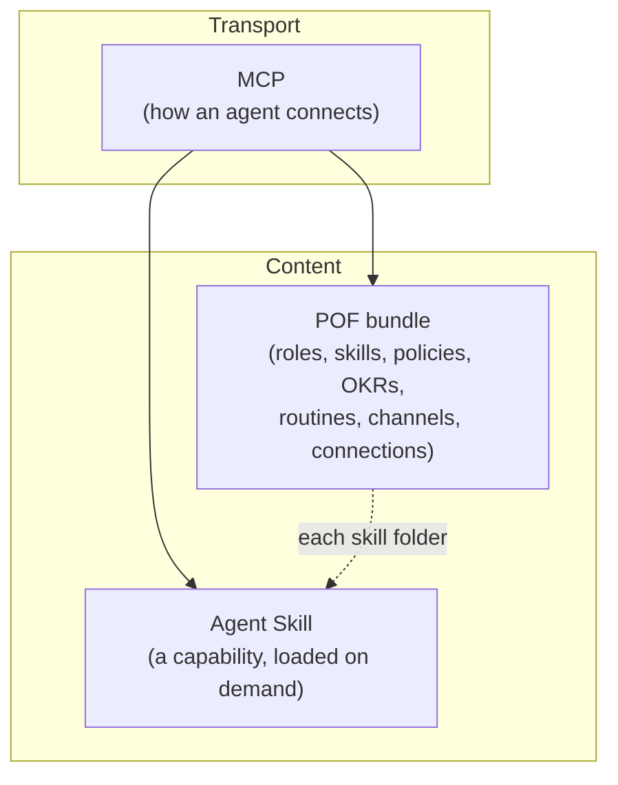

import { Callout } from "nextra/components";

# POF vs. MCP vs. Agent Skills

These three come up in the same sentence about making agents useful. They
sit next to each other, not on top of each other.

| | What it is | How POF relates |
|---|---|---|
| **MCP** | A protocol: how an agent reaches tools and resources. | POF is content. A system can serve the pieces of a bundle over MCP (see [Over MCP](/mcp)), and a [Connection](/format/connections) in a bundle can point at an MCP server. |
| **Agent Skills** | A folder an agent discovers by `name` and `description`, and reads in full when a task matches. | A POF [Skill](/format/skills) has that same shape. The other core types are what an organization holds whether or not an agent ever loads them. |
| **POF** | A bundle format for a whole organization. | Independent of any transport and of any system that writes it. |

Put plainly: **MCP is the wire, an Agent Skill is one capability an agent
loads on demand, and POF is the organization those capabilities belong
to**: its roles, its skills, its policies, its OKRs, its routines,
its channels and its connections, linked to each other.

## They compose

A skill in a POF bundle reads the way an agent expects an Agent Skill to
read. Around it, the bundle's links tell that agent which roles use the
skill, which routines those roles run and which channels and connections
they work through, all by path.

## When to reach for which

- A standard way for an agent to connect to a system: MCP.
- One repeatable capability an agent loads when relevant: an Agent
  Skill, which is also a POF Skill.
- The whole organization, in a form a person, an agent and another
  system can all read and import: POF.

<Callout type="warning">
  POF does not compete with MCP or Agent Skills. It names a shape for a
  wider thing, for the same reason Agent Skills named one: so it can be
  reused across systems.
</Callout>
